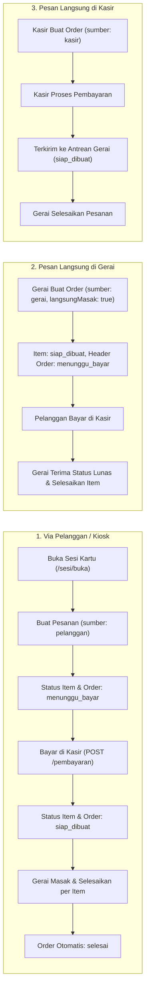

# Dokumentasi API — Kantin Sentral POS Backend

Dokumentasi resmi layanan REST API untuk **Kantin Sentral Pujasera (Multi-Gerai POS)**. Dokumen ini disusun sebagai acuan terpadu bagi **stakeholder** (pemilik usaha, tim produk, QA) dan **tim pengembang** (frontend kiosk, kasir, portal gerai, serta dashboard admin).

---

## Ringkasan Teknis & Status Verifikasi

| Aspek | Keterangan |
| :--- | :--- |
| **Base URL API** | `http://localhost:5000/api` *(dapat dikonfigurasi via `APP_URL` / `APP_PORT`)* |
| **Static Media URL** | `http://localhost:5000/uploads/menu/<filename>.webp` *(atau URL Cloudinary jika aktif)* |
| **Format Data** | JSON (`Content-Type: application/json`), khusus upload gambar menggunakan `multipart/form-data` |
| **Autentikasi** | JWT Bearer Token (`Authorization: Bearer <access_token>`, default kedaluwarsa `1d`) |
| **Database** | MySQL (`kantin_db`) dengan Prisma ORM v6 (8 tabel, relasi Foreign Key aktif) |
| **Total Endpoint** | **52 endpoint** pada **11 modul** fungsional |
| **Status Pengujian** | Terverifikasi melalui Newman (`bun run test:api`): **111/111 request**, **181/181 assertion lulus (0 gagal)** |

---

## Daftar Isi

1. [Peran Pengguna & Hak Akses (RBAC)](#1-peran-pengguna--hak-akses-rbac)
2. [Alur Bisnis & Siklus Status Pesanan](#2-alur-bisnis--siklus-status-pesanan)
3. [Standar Format Response & Penanganan Error](#3-standar-format-response--penanganan-error)
4. [Mekanisme Keamanan & Autentikasi Global](#4-mekanisme-keamanan--autentikasi-global)
5. [Indeks Lengkap 52 Endpoint](#5-indeks-lengkap-52-endpoint)
6. [Referensi Detail Endpoint per Modul](#6-referensi-detail-endpoint-per-modul)
   - [6.1 Health Check](#61-health-check)
   - [6.2 Autentikasi (`/auth`)](#62-autentikasi-auth)
   - [6.3 Manajemen Pengguna (`/pengguna`)](#63-manajemen-pengguna-pengguna)
   - [6.4 Manajemen Gerai (`/gerai`)](#64-manajemen-gerai-gerai)
   - [6.5 Manajemen Menu (`/menu`)](#65-manajemen-menu-menu)
   - [6.6 Manajemen Sesi Kartu & Meja (`/sesi`)](#66-manajemen-sesi-kartu--meja-sesi)
   - [6.7 Manajemen Pesanan & Antrean Dapur (`/pesanan`)](#67-manajemen-pesanan--antrean-dapur-pesanan)
   - [6.8 Pembayaran Kasir (`/pembayaran`)](#68-pembayaran-kasir-pembayaran)
   - [6.9 Laporan & Analitik (`/laporan`)](#69-laporan--analitik-laporan)
   - [6.10 Pengaturan Sistem (`/pengaturan`)](#610-pengaturan-sistem-pengaturan)
   - [6.11 Upload & Manajemen Media (`/upload`)](#611-upload--manajemen-media-upload)
7. [Panduan Menjalankan Server & Pengujian](#7-panduan-menjalankan-server--pengujian)

---

## 1. Peran Pengguna & Hak Akses (RBAC)

Sistem mendukung **4 peran (role)** dengan pembatasan akses di level route dan validasi kepemilikan data di controller:

| Role (`peran`) | Deskripsi Peran | Hak Akses Utama | Cara Mendapatkan Token |
| :--- | :--- | :--- | :--- |
| **`superadmin`** | Pemilik / Pengelola Kantin | Akses penuh: kelola staf/PIN, CRUD gerai, CRUD semua menu, tutup/ubah sesi, kelola semua pesanan, proses pembayaran, laporan omzet & rekap gerai, pengaturan kantin, upload/hapus gambar. | `POST /api/auth/login` atau `/verify-pin` |
| **`kasir`** | Petugas Meja Kasir | Lihat daftar sesi & antrean pesanan, ubah item pesanan sebelum dibayar, proses pembayaran tunggal/gabungan (`tunai`, `qris`, `debit`, `cash`), ubah status & batalkan pesanan, tutup sesi. | `POST /api/auth/login` atau `/verify-pin` |
| **`gerai`** | Tenant / Dapur Gerai (terikat `idGerai`) | Kelola menu **khusus gerai miliknya**, upload gambar menu, lihat antrean & selesaikan/batalkan item **milik gerainya** saja, serta input pesanan langsung dari gerai (`langsungMasak`). | `POST /api/auth/login` atau `/verify-pin` |
| **`pelanggan`** | Pengunjung / Kiosk Meja | Cek gerai/menu/pengaturan, cek & buka sesi kartu (`/sesi/buka`), buat pesanan (`POST /pesanan`), lacak pesanan by kartu/sesi/ID. Tidak bisa edit item, ubah status, bayar, atau melihat laporan/staf. | `POST /api/auth/guest` (UUID sementara) |

### Akun Bawaan Hasil Seeder (`bun run seed`)

> [!NOTE]
> Password/PIN staf disimpan menggunakan hash `bcryptjs` di database (`users.pin`). Akun demo di bawah tersedia otomatis setelah menjalankan `bun run seed`.

| Nama | Username | PIN | Role (`peran`) | Terikat Gerai (`idGerai`) |
| :--- | :--- | :--- | :--- | :--- |
| Pak Hendra (Pemilik) | `admin` | `123456` | `superadmin` | `-` |
| Siti Rahma (Kasir) | `kasir` | `112233` | `kasir` | `-` |
| Cik Ani (Pempek) | `pempek` | `1111` | `gerai` | `G01` |
| Kang Asep (Mie Celor) | `miecelor` | `2222` | `gerai` | `G02` |
| Bang Rudi (Nasi Goreng) | `nasgor` | `3333` | `gerai` | `G03` |
| Mbak Dewi (Es Teh & Jus) | `minuman` | `4444` | `gerai` | `G04` |

---

## 2. Alur Bisnis & Siklus Status Pesanan

### 2.1 Tiga Skenario Pemesanan POS

Sistem dirancang agar fleksibel mendukung transaksi **kiosk/mandiri**, **pesan langsung ke gerai**, maupun **pesan langsung di kasir** dalam satu model data yang konsisten:



### 2.2 Arsitektur Dual-Level Status (`pesanan.status` vs `item_pesanan.statusItem`)

Satu transaksi pesanan (`pesanan`) dapat berisi menu dari **beberapa gerai sekaligus** (misalnya Pempek dari `G01` dan Es Teh dari `G04`). Oleh karena itu, progres pengerjaan dicatat per item pada tabel `item_pesanan.statusItem`, sedangkan `pesanan.status` dihitung otomatis sebagai **status agregat** di dalam transaksi database (`syncPesananState`):

| Nilai Status | Makna pada `item_pesanan.statusItem` | Makna pada Header `pesanan.status` |
| :--- | :--- | :--- |
| **`menunggu_bayar`** | Item baru dibuat (belum dibayar / belum masuk antrean dapur) | **Belum ada pembayaran (`pembayaranId === null`)** walaupun ada item `langsungMasak` yang sudah mulai disiapkan gerai |
| **`siap_dibuat`** | Sudah dibayar (atau ditandai `langsungMasak` oleh gerai/superadmin), siap diproses dapur | Sudah dibayar (`pembayaranId !== null`), minimal 1 item aktif belum selesai |
| **`selesai`** | Item sudah selesai dibuat/disajikan oleh gerai bersangkutan | Sudah dibayar **dan** seluruh item aktif (non-batal) berstatus `selesai` |
| **`batal`** | Item dibatalkan | Seluruh item pada pesanan berstatus `batal` |

> [!IMPORTANT]
> Setiap perubahan status item, penambahan/perubahan item, pembayaran, atau pembatalan otomatis menghitung ulang:
> 1. `pesanan.total` (hanya menjumlahkan item non-batal jika masih ada item aktif),
> 2. `pesanan.status` (melalui `computeAggregateOrderStatus`), dan
> 3. `sesi.totalTagihan` (akumulasi seluruh `pesanan.total` non-batal yang terhubung ke `idSesi`).

### 2.3 Ringkasan Relasi Database MySQL (`kantin_db`)

| Tabel | Kunci Utama / Unik | Relasi Utama | Keterangan Penting |
| :--- | :--- | :--- | :--- |
| **`users`** | `id`, `username` | `idGerai -> gerai.kode` (`SetNull`) | Akun staf (`superadmin`, `kasir`, `gerai`); `pin` terenkripsi bcrypt. |
| **`gerai`** | `id`, `kode` | Parent bagi `menus`, `users`, `pesanan`, `item_pesanan` | Rename `gerai.nama` otomatis menyinkronkan `namaGerai` pada `menus`, `pesanan`, dan `item_pesanan`. |
| **`menus`** | `id`, `kode` | `idGerai -> gerai.kode` (`Restrict`) | Gerai tidak dapat dihapus permanen jika masih memiliki menu. |
| **`sesi`** | `id`, `idSesi` | Parent bagi `pesanan`, `pembayaran` | Sesi kunjungan berdasarkan `nomorKartu` (`1..99`) dan opsional `nomorMeja`. |
| **`pesanan`** | `id`, `idPesanan` | `idSesi -> sesi.idSesi`, `idGerai -> gerai.kode`, `pembayaranId -> pembayaran.id` | Header transaksi; mendukung 1 gerai atau lintas gerai (`idGerai` bernilai `null` jika multi-gerai saat pembuatan). |
| **`item_pesanan`** | `id` | `pesananId -> pesanan.id` (`Cascade`), `menuId -> menus.id`, `idGerai -> gerai.kode` | Menyimpan *snapshot* `namaMenu`, `namaGerai`, `hargaSaatItu`, `subtotal`, serta `statusItem` per baris menu. |
| **`pembayaran`** | `id` | `idSesi -> sesi.idSesi`, `kasirId -> users.id` | Dapat melunasi 1 pesanan (`idPesanan`) atau gabungan beberapa pesanan (`idPesananList`). |
| **`pengaturan`** | `id` | - | Konfigurasi kantin (nama, alamat, rentang kartu, footer struk, metode bayar aktif JSON). |

---

## 3. Standar Format Response & Penanganan Error

Seluruh endpoint mengembalikan payload JSON dengan pembungkus `meta`:

### Response Sukses (`200 OK` / `201 Created`)
```json
{
  "meta": {
    "status": 200,
    "message": "Pesan deskriptif hasil operasi"
  },
  "data": { ... }
}
```

### Response Validasi Zod (`422 Unprocessable Entity`)
```json
{
  "meta": {
    "status": 422,
    "message": "Validation error"
  },
  "errors": {
    "namaField": ["Pesan kesalahan validasi spesifik"]
  }
}
```

### Response Error Umum (`400`, `401`, `403`, `404`, `409`, `500`)
```json
{
  "meta": {
    "status": 400,
    "message": "Penjelasan alasan error"
  }
}
```
*(Saat `NODE_ENV !== "production"` dan status `500`, properti tambahan `"stack"` disertakan untuk keperluan debugging).*

### Tabel Kode Status HTTP

| Kode HTTP | Arti | Kondisi Umum Terjadinya |
| :--- | :--- | :--- |
| **`200 OK`** | Berhasil | Query `GET`, pembaruan `PUT`/`PATCH`, penghapusan `DELETE`, atau `POST /sesi/buka` jika sesi aktif sudah ada. |
| **`201 Created`** | Data Baru Dibuat | Pembuatan user, gerai, menu, sesi baru, pesanan baru, proses pembayaran, dan upload gambar. |
| **`400 Bad Request`** | Permintaan Tidak Valid | Aturan bisnis ditolak (menu habis, pesanan sudah bayar/batal, gerai masih punya menu), JSON malformed, relasi Prisma `P2003`, atau error `Multer` (file > `UPLOAD_MAX_SIZE_MB`, field bukan `image`, ekstensi tidak didukung). |
| **`401 Unauthorized`** | Belum Terautentikasi | Header `Authorization: Bearer <token>` kosong, token salah/kedaluwarsa, atau akun staf sudah dinonaktifkan (`aktif = false`). |
| **`403 Forbidden`** | Akses Ditolak | Role pengguna tidak diizinkan atau staf `gerai` mencoba mengakses/mengubah data milik gerai lain. |
| **`404 Not Found`** | Tidak Ditemukan | Endpoint tidak terdaftar, ID/kode entitas tidak ada, atau error Prisma `P2025`. |
| **`409 Conflict`** | Duplikasi Data | Data unik (`username`, `gerai.kode`, `menus.kode`, `idPesanan`) sudah terdaftar (Prisma `P2002`). |
| **`422 Unprocessable Entity`** | Gagal Validasi Input | Input melanggar skema Zod atau upload tanpa file / hapus gambar tanpa `publicId`. |

---

## 4. Mekanisme Keamanan & Autentikasi Global

1. **Middleware Global (`requireJwtExceptGet`)**:
   - Seluruh endpoint tulis (`POST`, `PUT`, `PATCH`, `DELETE`) di bawah `/api` selain `/api/auth/login`, `/api/auth/verify-pin`, dan `/api/auth/guest` **wajib** menyertakan header `Authorization: Bearer <token>`.
   - Token staf diverifikasi langsung ke database pada setiap request untuk memastikan pengguna masih ada dan berstatus `aktif = true`.
2. **Keamanan Endpoint `GET`**:
   - **Publik (tanpa token)** untuk mendukung menu digital & kiosk pelanggan: `/api/health`, `/api/gerai`, `/api/gerai/:id`, `/api/menu`, `/api/menu/gerai/:idGerai`, `/api/menu/:id`, `/api/sesi/aktif/:nomorKartu`, `/api/sesi/:id`, `/api/pesanan/kartu/:nomorKartu`, `/api/pesanan/sesi/:idSesi`, `/api/pesanan/:id`, `/api/pengaturan`.
   - **Wajib Token + Role Khusus**: `/api/auth/me`, semua `/api/pengguna*`, `GET /api/sesi`, `GET /api/pesanan`, `GET /api/pesanan/gerai/:idGerai`, semua `/api/pembayaran*`, dan semua `/api/laporan*`.
3. **CORS**: Mengizinkan origin dari `FRONTEND_URL` (default `http://localhost:3000`) dengan `credentials: true`.

---

## 5. Indeks Lengkap 52 Endpoint

| Modul | Method | Endpoint | Autentikasi / Role | Deskripsi Singkat |
| :--- | :--- | :--- | :--- | :--- |
| **Health** | `GET` | `/api/health` | Publik | Cek status kesehatan server API |
| **Auth** | `POST` | `/api/auth/login` | Publik | Login staf dengan PIN (+ opsional `username`) |
| **Auth** | `POST` | `/api/auth/verify-pin` | Publik | Alias login cepat dengan PIN |
| **Auth** | `POST` | `/api/auth/guest` | Publik | Terbitkan JWT sementara untuk `pelanggan` |
| **Auth** | `GET` | `/api/auth/me` | Wajib JWT (Semua Role*) | Ambil profil akun staf aktif dari token |
| **Pengguna** | `GET` | `/api/pengguna` | `superadmin` | Daftar semua pengguna (filter `peran`, `aktif`) |
| **Pengguna** | `GET` | `/api/pengguna/:id` | `superadmin` | Detail satu pengguna berdasarkan ID numerik |
| **Pengguna** | `POST` | `/api/pengguna` | `superadmin` | Tambah akun staf baru (PIN otomatis di-hash) |
| **Pengguna** | `PUT` | `/api/pengguna/:id` | `superadmin` | Pembaruan data pengguna |
| **Pengguna** | `PATCH` | `/api/pengguna/:id` | `superadmin` | Pembaruan parsial data pengguna |
| **Pengguna** | `PATCH` | `/api/pengguna/:id/pin` | `superadmin` | Ganti PIN pengguna |
| **Pengguna** | `DELETE` | `/api/pengguna/:id` | `superadmin` | Soft delete (`aktif=false`) atau permanen (`?permanent=true`) |
| **Gerai** | `GET` | `/api/gerai` | Publik | Daftar gerai (filter `?aktif=true/false`) |
| **Gerai** | `GET` | `/api/gerai/:id` | Publik | Detail gerai via ID numerik atau `kode` (`G01`) |
| **Gerai** | `POST` | `/api/gerai` | `superadmin` | Tambah gerai/tenant baru |
| **Gerai** | `PUT` | `/api/gerai/:id` | `superadmin` | Perbarui gerai + sinkronisasi `namaGerai` |
| **Gerai** | `PATCH` | `/api/gerai/:id` | `superadmin` | Perbarui parsial gerai + sinkronisasi `namaGerai` |
| **Gerai** | `DELETE` | `/api/gerai/:id` | `superadmin` | Nonaktifkan gerai atau hapus permanen (`?permanent=true`) |
| **Menu** | `GET` | `/api/menu` | Publik | Daftar menu (filter `idGerai`, `kategori`, `isHabis`, `aktif`, `search`) |
| **Menu** | `GET` | `/api/menu/gerai/:idGerai` | Publik | Daftar menu aktif milik satu gerai |
| **Menu** | `GET` | `/api/menu/:id` | Publik | Detail menu via ID numerik atau `kode` (`G01-001`) |
| **Menu** | `POST` | `/api/menu` | `superadmin`, `gerai` | Tambah menu baru (`gerai` hanya untuk gerainya) |
| **Menu** | `PUT` | `/api/menu/:id` | `superadmin`, `gerai` | Perbarui menu (`gerai` hanya untuk gerainya) |
| **Menu** | `PATCH` | `/api/menu/:id` | `superadmin`, `gerai` | Perbarui parsial menu (`gerai` hanya untuk gerainya) |
| **Menu** | `PATCH` | `/api/menu/:id/toggle-habis` | `superadmin`, `gerai` | Toggle atau set `isHabis`, `aktif`, `isFavorit` |
| **Menu** | `DELETE` | `/api/menu/:id` | `superadmin`, `gerai` | Nonaktifkan menu atau hapus permanen (`?permanent=true`) |
| **Sesi** | `GET` | `/api/sesi` | `superadmin`, `kasir` | Daftar sesi kunjungan (filter `status`, `nomorKartu`) |
| **Sesi** | `GET` | `/api/sesi/aktif/:nomorKartu` | Publik | Cek apakah nomor kartu memiliki sesi `aktif` |
| **Sesi** | `GET` | `/api/sesi/:id` | Publik | Detail sesi via ID numerik atau `idSesi` |
| **Sesi** | `POST` | `/api/sesi/buka` | Wajib JWT (Semua Role) | Buka sesi baru (atau kembalikan sesi aktif yang ada) |
| **Sesi** | `PATCH` | `/api/sesi/:id/tutup` | `superadmin`, `kasir` | Tutup sesi menjadi `lunas` dan isi `waktuTutup` |
| **Sesi** | `PATCH` | `/api/sesi/:id/status` | `superadmin`, `kasir` | Ubah `status` sesi (`aktif`/`lunas`/`batal`/`tidak_dibayar`) & `totalTagihan` |
| **Pesanan** | `GET` | `/api/pesanan` | `superadmin`, `kasir`, `gerai` | Daftar pesanan (staf `gerai` otomatis terfilter gerainya) |
| **Pesanan** | `GET` | `/api/pesanan/kartu/:nomorKartu` | Publik | Riwayat pesanan berdasarkan `nomorKartu` |
| **Pesanan** | `GET` | `/api/pesanan/gerai/:idGerai` | `superadmin`, `gerai` | Antrean pesanan milik satu gerai |
| **Pesanan** | `GET` | `/api/pesanan/sesi/:idSesi` | Publik | Daftar pesanan dalam satu `idSesi` |
| **Pesanan** | `GET` | `/api/pesanan/:id` | Publik | Detail pesanan + `items` + `pembayaran` |
| **Pesanan** | `POST` | `/api/pesanan` | Wajib JWT (Semua Role) | Buat pesanan baru (mendukung multi-gerai & `langsungMasak`) |
| **Pesanan** | `PATCH` | `/api/pesanan/:id/status` | `superadmin`, `kasir`, `gerai` | Update status semua item aktif (atau per gerai) lalu sinkronkan header |
| **Pesanan** | `PATCH` | `/api/pesanan/:id/items/:itemId/status` | `superadmin`, `kasir`, `gerai` | Update `statusItem` untuk 1 baris item spesifik lalu sinkronkan header |
| **Pesanan** | `PUT` | `/api/pesanan/:id/items` | `superadmin`, `kasir` | Ganti/edit daftar item pesanan sebelum dibayar/batal |
| **Pesanan** | `PATCH` | `/api/pesanan/:id/batal` | `superadmin`, `kasir`, `gerai` | Batalkan seluruh pesanan atau item milik gerai tertentu |
| **Pembayaran** | `GET` | `/api/pembayaran` | `superadmin`, `kasir` | Riwayat transaksi pembayaran (filter `idKasir`, `metode`) |
| **Pembayaran** | `GET` | `/api/pembayaran/:id` | `superadmin`, `kasir` | Detail satu transaksi pembayaran (ID numerik) |
| **Pembayaran** | `POST` | `/api/pembayaran` | `superadmin`, `kasir` | Proses pembayaran 1 atau banyak pesanan sekaligus |
| **Laporan** | `GET` | `/api/laporan/rekap-gerai` | `superadmin` | Rekap transaksi, porsi terjual, & omzet per gerai |
| **Laporan** | `GET` | `/api/laporan/ringkasan` | `superadmin` | KPI ringkasan dashboard & rincian metode bayar |
| **Pengaturan** | `GET` | `/api/pengaturan` | Publik | Ambil konfigurasi sistem kantin |
| **Pengaturan** | `PUT` | `/api/pengaturan` | `superadmin` | Perbarui konfigurasi sistem kantin |
| **Pengaturan** | `PATCH` | `/api/pengaturan` | `superadmin` | Perbarui parsial konfigurasi sistem kantin |
| **Upload** | `POST` | `/api/upload` | `superadmin`, `gerai` | Upload gambar menu (otomatis dikonversi ke WebP <= 800px) |
| **Upload** | `DELETE` | `/api/upload` | `superadmin`, `gerai` | Hapus file gambar berdasarkan `publicId` & `provider` |

*\*Catatan `GET /api/auth/me`: token `pelanggan` memiliki `sub` berupa UUID non-numerik sehingga akan menerima `404 Pengguna tidak ditemukan`.*

---

## 6. Referensi Detail Endpoint per Modul

### 6.1 Health Check

#### `GET /api/health`
- **Akses**: Publik (Tanpa Token)
- **Fungsi**: Memastikan API aktif serta memeriksa timestamp server.
- **Response (`200 OK`)**:
```json
{
  "meta": {
    "status": 200,
    "message": "Backend Kantin API is healthy and running"
  },
  "data": {
    "timestamp": "2026-11-28T07:00:00.000Z"
  }
}
```

---

### 6.2 Autentikasi (`/auth`)

#### `POST /api/auth/login` dan `POST /api/auth/verify-pin`
- **Akses**: Publik (Tanpa Token)
- **Fungsi**: Autentikasi pengguna staf (`superadmin`, `kasir`, `gerai`) menggunakan PIN. Apabila `username` tidak disertakan (mode keypad PIN cepat), sistem mencocokkan PIN pada seluruh pengguna `aktif = true`.
- **Request Body**:

| Field | Tipe | Wajib | Aturan Validasi |
| :--- | :--- | :--- | :--- |
| `username` | `string` | Opsional | Otomatis diubah ke huruf kecil (`toLowerCase`) |
| `pin` | `string` | **Ya** | 4–6 digit angka numerik (`/^\d+$/`) |

- **Contoh Request**:
```json
{
  "username": "kasir",
  "pin": "112233"
}
```
- **Response (`200 OK`)**:
```json
{
  "meta": {
    "status": 200,
    "message": "Login berhasil"
  },
  "data": {
    "user": {
      "id": 2,
      "nama": "Siti Rahma (Kasir)",
      "username": "kasir",
      "peran": "kasir",
      "idGerai": null,
      "aktif": true
    },
    "access_token": "eyJhbGciOiJIUzI1NiIs...",
    "token_type": "Bearer"
  }
}
```
- **Kemungkinan Error**: `401` (PIN salah atau akun tidak aktif), `422` (format PIN tidak valid).

#### `POST /api/auth/guest`
- **Akses**: Publik (Tanpa Token)
- **Fungsi**: Menerbitkan JWT sementara dengan `peran: "pelanggan"` dan `sub` berupa UUID acak agar perangkat kiosk/pelanggan dapat membuka sesi (`POST /sesi/buka`) dan membuat pesanan (`POST /pesanan`).
- **Request Body**: Tidak diperlukan (`{}`).
- **Response (`200 OK`)**:
```json
{
  "meta": {
    "status": 200,
    "message": "Token pelanggan berhasil dibuat"
  },
  "data": {
    "access_token": "eyJhbGciOiJIUzI1NiIs...",
    "token_type": "Bearer",
    "peran": "pelanggan"
  }
}
```

#### `GET /api/auth/me`
- **Akses**: Wajib JWT (khusus akun staf terdaftar di tabel `users`)
- **Fungsi**: Mengambil profil staf yang sedang login tanpa field `pin`.
- **Response (`200 OK`)**: Objek profil user (`id`, `nama`, `username`, `peran`, `idGerai`, `aktif`, `createdAt`, `updatedAt`).
- **Kemungkinan Error**: `401` (tanpa token / token invalid / akun dinonaktifkan), `404` (ID pengguna tidak ditemukan / memakai token guest UUID).

---

### 6.3 Manajemen Pengguna (`/pengguna`)

Seluruh endpoint pada modul ini **wajib JWT dengan role `superadmin`**. PIN tidak pernah dikembalikan dalam response API.

#### `GET /api/pengguna`
- **Query Parameters**:
  - `peran` *(opsional)*: `superadmin` | `kasir` | `gerai` | `pelanggan`
  - `aktif` *(opsional)*: `true` | `false`
- **Response (`200 OK`)**: Array objek pengguna diurutkan dari terbaru (`createdAt desc`).

#### `GET /api/pengguna/:id`
- **Path Parameter**: `id` (ID numerik pengguna).
- **Kemungkinan Error**: `404` jika ID bukan integer positif atau pengguna tidak ditemukan.

#### `POST /api/pengguna`
- **Request Body**:

| Field | Tipe | Wajib | Aturan Validasi |
| :--- | :--- | :--- | :--- |
| `nama` | `string` | **Ya** | 2–100 karakter |
| `username` | `string` | **Ya** | 3–50 karakter, unik, huruf/angka/underscore (`/^[a-zA-Z0-9_]+$/`) |
| `pin` | `string` | **Ya** | 4–6 digit numerik (otomatis di-hash `bcryptjs`) |
| `peran` | `enum` | **Ya** | `superadmin` \| `kasir` \| `gerai` \| `pelanggan` |
| `idGerai` | `string \| null` | Opsional | Kode gerai (misal `"G01"`). Diwajibkan valid jika `peran === "gerai"`; otomatis diabaikan (`null`) jika `peran !== "gerai"`. |
| `aktif` | `boolean` | Opsional | Default `true` |

- **Kemungkinan Error**: `404` (`idGerai` tidak ditemukan), `409` (`username` duplikat), `422` (validasi gagal).

#### `PUT /api/pengguna/:id` & `PATCH /api/pengguna/:id`
- **Request Body**: Semua field (`nama`, `username`, `pin`, `peran`, `idGerai`, `aktif`) bersifat opsional.
- **Aturan Bisnis**: Jika role hasil pembaruan bukan `'gerai'`, sistem otomatis mereset `idGerai` menjadi `null`.
- **Kemungkinan Error**: `404` (user atau `idGerai` tidak ada), `409` (`username` duplikat), `422`.

#### `PATCH /api/pengguna/:id/pin`
- **Request Body**: `{ "pinBaru": "654321" }` (4–6 digit numerik).
- **Response (`200 OK`)**: Profil pengguna setelah PIN baru di-hash.

#### `DELETE /api/pengguna/:id`
- **Query Parameter**: `permanent=true` *(opsional)*.
- **Perilaku**:
  - Default (tanpa `permanent=true`): **Soft delete**, mengubah `aktif: false` dan mengembalikan data pengguna.
  - Dengan `?permanent=true`: Menghapus baris pengguna secara permanen dari database.

---

### 6.4 Manajemen Gerai (`/gerai`)

#### `GET /api/gerai`
- **Akses**: Publik
- **Query Parameter**: `aktif` *(opsional)*: `true` | `false`
- **Response (`200 OK`)**: Array daftar gerai diurutkan berdasarkan `kode asc`.

#### `GET /api/gerai/:id`
- **Akses**: Publik
- **Path Parameter**: `id` dapat berupa **ID numerik** (misal `1`) maupun **kode gerai** (misal `G01`, *case-insensitive*).
- **Kemungkinan Error**: `404` jika tidak ditemukan.

#### `POST /api/gerai`
- **Akses**: `superadmin`
- **Request Body**:

| Field | Tipe | Wajib | Aturan Validasi |
| :--- | :--- | :--- | :--- |
| `kode` | `string` | **Ya** | 2–10 karakter, unik, otomatis uppercase (contoh: `"G05"`) |
| `nama` | `string` | **Ya** | 2–100 karakter |
| `penyewa` | `string` | **Ya** | 2–100 karakter |
| `warna` | `string` | Opsional | Format HEX `#FFF` atau `#FFFFFF`, default `"#F97316"` |
| `aktif` | `boolean` | Opsional | Default `true` |

- **Response (`201 Created`)** | **Error**: `409` (kode duplikat), `422` (validasi gagal).

#### `PUT /api/gerai/:id` & `PATCH /api/gerai/:id`
- **Akses**: `superadmin`
- **Request Body**: Field parsial dari `createGeraiSchema`.
- **Sinkronisasi Otomatis**: Jika `nama` berubah, sistem otomatis memperbarui kolom `namaGerai` pada tabel `menus`, `pesanan`, dan `item_pesanan` yang berelasi dalam satu transaksi.

#### `DELETE /api/gerai/:id`
- **Akses**: `superadmin`
- **Query Parameter**: `permanent=true` *(opsional)*.
- **Perilaku**:
  - Default: Soft delete (`aktif: false`).
  - `?permanent=true`: Memeriksa jumlah menu terdaftar pada gerai tersebut. Jika masih memiliki menu (`menuCount > 0`), ditolak dengan `400 Bad Request`; jika kosong, gerai dihapus permanen.

---

### 6.5 Manajemen Menu (`/menu`)

#### `GET /api/menu`
- **Akses**: Publik
- **Query Parameters**:
  - `idGerai` *(opsional)*: Filter berdasarkan kode gerai (contoh `G01`).
  - `kategori` *(opsional)*: `makanan` | `minuman` | `camilan`.
  - `isHabis` *(opsional)*: `true` | `false`.
  - `aktif` *(opsional)*: `true` | `false` *(jika tidak dikirim, default hanya menampilkan `aktif = true`)*.
  - `search` *(opsional)*: Pencarian substring pada `nama` atau `kode` menu.
- **Urutan**: `urutan asc`, lalu `createdAt desc`.

#### `GET /api/menu/gerai/:idGerai`
- **Akses**: Publik
- **Fungsi**: Mengambil daftar seluruh menu dengan `aktif = true` milik gerai `:idGerai`.

#### `GET /api/menu/:id`
- **Akses**: Publik
- **Path Parameter**: `:id` dapat berupa **ID numerik** (`1`) atau **kode menu** (`G01-001`, *case-insensitive*).

#### `POST /api/menu`
- **Akses**: `superadmin`, `gerai` *(role `gerai` hanya boleh menambah menu untuk `idGerai` miliknya sendiri, selain itu `403 Forbidden`)*.
- **Request Body**:

| Field | Tipe | Wajib | Aturan Validasi |
| :--- | :--- | :--- | :--- |
| `kode` | `string` | **Ya** | 2–20 karakter, unik |
| `nama` | `string` | **Ya** | 2–100 karakter |
| `harga` | `integer` | **Ya** | Bilangan bulat `>= 0` |
| `idGerai` | `string` | **Ya** | 1–10 karakter, harus mengacu ke `gerai.kode` yang valid |
| `namaGerai` | `string` | Opsional | Maks 100 karakter (otomatis diisi dari nama gerai jika dikosongkan) |
| `kategori` | `enum` | Opsional | `makanan` \| `minuman` \| `camilan` (default `makanan`) |
| `foto` | `string \| null` | Opsional | URL gambar hasil `/api/upload` (maks 500 karakter; default `"/images/menu/placeholder.jpg"`) |
| `urutan` | `integer` | Opsional | Bilangan bulat positif (default `99`) |
| `isFavorit` | `boolean` | Opsional | Default `false` |
| `isHabis` | `boolean` | Opsional | Default `false` |
| `aktif` | `boolean` | Opsional | Default `true` |

- **Response (`201 Created`)** | **Error**: `403`, `404` (`gerai` tidak ada), `409` (`kode` duplikat), `422`.

#### `PUT /api/menu/:id` & `PATCH /api/menu/:id`
- **Akses**: `superadmin`, `gerai` *(role `gerai` tidak boleh mengubah menu gerai lain atau memindahkan `idGerai` ke gerai lain -> `403`)*.
- **Manajemen Media**: Jika field `foto` diganti dengan URL baru, file foto sebelumnya di penyimpanan lokal/Cloudinary akan otomatis dihapus di background.

#### `PATCH /api/menu/:id/toggle-habis`
- **Akses**: `superadmin`, `gerai`
- **Request Body**: Opsional (`{ "isHabis": true, "aktif": true, "isFavorit": false }`). Jika body kosong (`{}`), otomatis membalik nilai `isHabis` saat ini (`!menu.isHabis`).

#### `DELETE /api/menu/:id`
- **Akses**: `superadmin`, `gerai`
- **Query Parameter**: `permanent=true` *(opsional)*.
- **Perilaku**: Default menonaktifkan (`aktif: false`). Jika `?permanent=true`, record menu dihapus dan file gambar non-placeholder ikut dibersihkan.

---

### 6.6 Manajemen Sesi Kartu & Meja (`/sesi`)

#### `GET /api/sesi`
- **Akses**: `superadmin`, `kasir`
- **Query Parameters**: `status` (`aktif` | `lunas` | `batal` | `tidak_dibayar`), `nomorKartu` (integer).
- **Urutan**: `waktuBuka desc`.

#### `GET /api/sesi/aktif/:nomorKartu`
- **Akses**: Publik
- **Fungsi**: Mengambil sesi berstatus `aktif` untuk kartu nomor tertentu. Mengembalikan `404` jika kartu tidak sedang digunakan.

#### `GET /api/sesi/:id`
- **Akses**: Publik
- **Path Parameter**: `:id` berupa ID numerik atau `idSesi` (contoh `SESI-20261128-05123`).

#### `POST /api/sesi/buka`
- **Akses**: Wajib JWT (Semua Role, termasuk `pelanggan`)
- **Request Body**:

| Field | Tipe | Wajib | Aturan Validasi |
| :--- | :--- | :--- | :--- |
| `nomorKartu` | `integer` | **Ya** | Bilangan bulat `1` s/d `99` |
| `nomorMeja` | `integer \| null` | Opsional | Bilangan bulat positif |

- **Perilaku Idempoten**:
  - Jika `nomorKartu` sudah memiliki sesi `aktif`, API mengembalikan **`200 OK`** beserta data sesi aktif yang sudah ada (`"Sesi aktif sudah tersedia"`).
  - Jika belum ada, API membuat `idSesi` baru format `SESI-YYYYMMDD-<kartu><3-digit-acak>` dan mengembalikan **`201 Created`**.

#### `PATCH /api/sesi/:id/tutup`
- **Akses**: `superadmin`, `kasir`
- **Fungsi**: Menandai sesi sebagai `lunas` dan mengisi `waktuTutup` dengan waktu saat ini.

#### `PATCH /api/sesi/:id/status`
- **Akses**: `superadmin`, `kasir`
- **Request Body**: `{ "status": "batal" | "lunas" | "aktif" | "tidak_dibayar", "totalTagihan": 50000 }` *(keduanya opsional)*.
- **Catatan**: Mengubah `status` selain `'aktif'` otomatis mengisi `waktuTutup`.

---

### 6.7 Manajemen Pesanan & Antrean Dapur (`/pesanan`)

#### `GET /api/pesanan`
- **Akses**: `superadmin`, `kasir`, `gerai`
- **Query Parameters**: `nomorKartu`, `idSesi`, `status`, `idGerai` *(untuk `gerai`, filter `idGerai` dikunci otomatis ke `req.user.idGerai` milik staf)*.
- **Response (`200 OK`)**: Daftar pesanan lengkap dengan array `items` dan relasi `pembayaran`, diurutkan `waktuPesan desc`.

#### `GET /api/pesanan/kartu/:nomorKartu` & `GET /api/pesanan/sesi/:idSesi`
- **Akses**: Publik (untuk pelacakan status pesanan oleh kiosk/pelanggan).

#### `GET /api/pesanan/gerai/:idGerai`
- **Akses**: `superadmin`, `gerai` *(role `gerai` ditolak `403` jika meminta `:idGerai` milik gerai lain)*.
- **Fungsi**: Menampilkan semua pesanan yang memiliki `pesanan.idGerai === :idGerai` **atau** minimal 1 item milik `:idGerai` (mendukung pesanan gabungan multi-gerai).

#### `GET /api/pesanan/:id`
- **Akses**: Publik
- **Path Parameter**: `:id` dapat berupa ID numerik (`15`) atau kode transaksi `idPesanan` (`TRX-889885`).

#### `POST /api/pesanan`
- **Akses**: Wajib JWT (Semua Role)
- **Request Body**:

| Field | Tipe | Wajib | Aturan Validasi |
| :--- | :--- | :--- | :--- |
| `idPesanan` | `string` | Opsional | Maks 50 karakter (otomatis dibuat `TRX-<nomorKartu><4-digit>` jika kosong) |
| `nomorKartu` | `string` | **Ya** | 1–10 karakter (contoh `"05"`) |
| `nomorMeja` | `integer \| null` | Opsional | Bilangan bulat positif |
| `idGerai` | `string \| null` | Opsional | Harus ada di tabel `gerai` jika diisi *(otomatis terisi jika pesanan hanya berisi 1 item)* |
| `namaGerai` | `string \| null` | Opsional | Otomatis diisi dari data `gerai` |
| `idSesi` | `string \| null` | Opsional | Harus ada di tabel `sesi` jika diisi |
| `sumber` | `enum` | Opsional | `pelanggan` \| `gerai` \| `kasir` (default `"pelanggan"`) |
| `langsungMasak` | `boolean` | Opsional | Default `false`. Hanya berlaku bila role pembuat adalah `gerai` atau `superadmin`: `statusItem` awal menjadi `siap_dibuat`, namun header `pesanan.status` tetap `menunggu_bayar` hingga dibayar. |
| `catatan` | `string \| null` | Opsional | Maks 255 karakter |
| `items` | `array` | **Ya** | Minimal 1 objek `{ idMenu, jumlah (>=1), catatan? }` (`idMenu` bisa berupa ID numerik atau `kode` menu) |

- **Aturan Bisnis & Keamanan**:
  - Harga item selalu dihitung ulang dari database (`menu.harga * jumlah`) sehingga aman dari manipulasi client.
  - Menu yang tidak aktif (`aktif: false`) ditolak `404`; menu yang habis (`isHabis: true`) ditolak `400`.
  - Jika role `gerai` membuat pesanan dengan `sumber: "gerai"` menggunakan menu milik gerai lain, permintaan ditolak `403`.
  - Jika terhubung ke `idSesi`, `sesi.totalTagihan` langsung tersinkronisasi.
- **Contoh Request (Multi-Gerai)**:
```json
{
  "nomorKartu": "05",
  "nomorMeja": 12,
  "idSesi": "SESI-20261128-05123",
  "sumber": "pelanggan",
  "catatan": "Pedas sedang",
  "items": [
    { "idMenu": "G01-001", "jumlah": 1, "catatan": "Kuah cuko dipisah" },
    { "idMenu": "G04-001", "jumlah": 2 }
  ]
}
```
- **Response (`201 Created`)**: Mengembalikan header `pesanan`, array `items` (masing-masing lengkap dengan `statusItem`), serta `pembayaran: null`.

#### `PATCH /api/pesanan/:id/status`
- **Akses**: `superadmin`, `kasir`, `gerai`
- **Request Body**:
```json
{
  "status": "selesai",
  "idGerai": "G01"
}
```
- *Alias status yang diterima*: `menunggu_bayar` (`pending_payment`), `siap_dibuat` (`ready_to_prepare`), `selesai` (`completed`), `batal` (`cancelled`).
- **Perilaku**:
  - Role `gerai` hanya memperbarui `statusItem` milik gerainya (`req.user.idGerai`) dan menjaga item gerai lain tetap pada status masing-masing.
  - Role `superadmin`/`kasir` dapat memfilter dengan `idGerai` di body atau memperbarui semua item non-batal sekaligus.
  - Status header `pesanan.status` otomatis dihitung ulang (`syncPesananState`).

#### `PATCH /api/pesanan/:id/items/:itemId/status`
- **Akses**: `superadmin`, `kasir`, `gerai`
- **Fungsi**: Mengubah `statusItem` tepat **1 baris item** (`:itemId`) pada pesanan `:id`, lalu menyinkronkan status header pesanan dan tagihan sesi.
- **Request Body**: `{ "status": "selesai" }` *(menerima enum `StatusPesanan` atau alias bahasa Inggris)*.
- **Proteksi**: Role `gerai` ditolak `403` jika `:itemId` bukan milik gerainya.

#### `PUT /api/pesanan/:id/items`
- **Akses**: `superadmin`, `kasir`
- **Fungsi**: Mengganti daftar item pada pesanan dan menghitung ulang total tagihan pesanan & sesi.
- **Request Body**: `{ "items": [ { "idMenu": "G01-001", "jumlah": 1 } ] }`
- **Penolakan (`400 Bad Request`)**:
  - Ditolak jika pesanan **sudah dibayar** (`pembayaranId !== null`).
  - Ditolak jika pesanan **sudah dibatalkan** (`status === "batal"`).

#### `PATCH /api/pesanan/:id/batal`
- **Akses**: `superadmin`, `kasir`, `gerai`
- **Request Body**: `{ "idGerai": "G01" }` *(opsional bagi `superadmin`/`kasir` untuk membatalkan item gerai tertentu saja; bagi `gerai`, otomatis hanya item milik gerainya yang diubah menjadi `batal`)*.
- **Perilaku**: Item yang dibatalkan menjadi `statusItem = "batal"`, `pesanan.total` & `sesi.totalTagihan` otomatis dikurangi, dan jika semua item batal maka header `pesanan.status` ikut menjadi `batal`.

---

### 6.8 Pembayaran Kasir (`/pembayaran`)

Seluruh endpoint modul ini **khusus role `superadmin` dan `kasir`**.

#### `GET /api/pembayaran`
- **Query Parameters**: `idKasir`, `metode` (`tunai` | `qris` | `debit` | `cash`).
- **Urutan**: `waktuBayar desc`.

#### `GET /api/pembayaran/:id`
- **Path Parameter**: `:id` (ID numerik pembayaran). Mengembalikan `404` jika tidak ditemukan.

#### `POST /api/pembayaran`
- **Fungsi**: Mencatat transaksi pembayaran untuk **satu pesanan** (`idPesanan`) atau **banyak pesanan sekaligus** (`idPesananList`) dalam satu sesi kartu meja secara atomik (`prisma.$transaction`).
- **Request Body**:

| Field | Tipe | Wajib | Aturan Validasi |
| :--- | :--- | :--- | :--- |
| `idPesanan` | `string` | Salah satu wajib | ID numerik atau `idPesanan` (`TRX-...`) |
| `idPesananList` | `string[]` | Salah satu wajib | Array ID/kode pesanan untuk pembayaran gabungan |
| `idSesi` | `string \| null` | Opsional | Otomatis diambil dari pesanan pertama jika dikosongkan |
| `metode` | `enum` | **Ya** | `tunai` \| `qris` \| `debit` \| `cash` |
| `totalTagihan` | `integer` | **Ya** | Bilangan bulat `>= 0` |
| `uangDiterima` | `integer` | **Ya** | Bilangan bulat `>= 0`. Wajib `>= totalTagihan` jika metode `tunai` atau `cash` |
| `referensiQris` | `string \| null` | Opsional | Kode referensi pembayaran QRIS / EDC |
| `idKasir` | `string \| null` | Opsional | Otomatis memakai `req.user.id` dari JWT kasir yang bertugas |

- **Dampak Transaksi**:
  1. Memverifikasi setiap pesanan ada (`404`), belum berstatus `batal` (`400`), dan belum pernah dibayar (`pembayaranId === null`, jika sudah lunas -> `400`).
  2. Menghitung `kembalian = Math.max(0, uangDiterima - totalTagihan)` untuk pembayaran tunai/cash (dan `0` untuk non-tunai).
  3. Menghubungkan `pesanan.pembayaranId`, memajukan seluruh item berstatus `menunggu_bayar` -> `siap_dibuat`, serta menyinkronkan status header `pesanan` dan `sesi.totalTagihan`.
- **Contoh Request**:
```json
{
  "idPesanan": "TRX-051234",
  "idSesi": "SESI-20261128-05123",
  "metode": "tunai",
  "totalTagihan": 31000,
  "uangDiterima": 50000
}
```
- **Response (`201 Created`)**:
```json
{
  "meta": {
    "status": 201,
    "message": "Pembayaran berhasil diproses"
  },
  "data": {
    "pembayaran": {
      "id": 1,
      "idPesanan": "TRX-051234",
      "idSesi": "SESI-20261128-05123",
      "kasirId": 2,
      "idKasir": "2",
      "metode": "tunai",
      "totalTagihan": 31000,
      "uangDiterima": 50000,
      "kembalian": 19000,
      "referensiQris": null,
      "waktuBayar": "2026-11-28T06:45:00.000Z"
    },
    "pesanan": {
      "idPesanan": "TRX-051234",
      "status": "siap_dibuat",
      "pembayaranId": 1,
      "items": [ ... ]
    }
  }
}
```

---

### 6.9 Laporan & Analitik (`/laporan`)

Seluruh endpoint laporan **wajib JWT role `superadmin`** dan mendukung filter waktu fleksibel (zona waktu `WIB / UTC+7`):

| Query Parameter | Format | Keterangan |
| :--- | :--- | :--- |
| `tanggal` | `YYYY-MM-DD` | Filter satu tanggal tertentu (default: tanggal hari ini WIB jika tidak ada filter) |
| `startDate` & `endDate` | `YYYY-MM-DD` | Filter rentang tanggal inklusif (`00:00:00+07:00` s/d `23:59:59+07:00`) |
| `all` | `'true'` \| `'false'` | Jika `'true'`, menampilkan akumulasi seluruh waktu (`label: "semua"`) |

#### `GET /api/laporan/rekap-gerai`
- **Fungsi**: Menghitung total transaksi unik, jumlah porsi terjual, dan total omzet untuk setiap gerai aktif (`pesanan.status` masuk `siap_dibuat` / `selesai` dan item tidak `batal`).
- **Response (`200 OK`)**:
```json
{
  "meta": {
    "status": 200,
    "message": "Rekapitulasi harian per gerai"
  },
  "data": [
    {
      "idGerai": "G01",
      "namaGerai": "Pempek Cik Ani",
      "tanggal": "2026-11-28",
      "totalTransaksi": 12,
      "totalPorsi": 28,
      "totalOmzet": 640000
    }
  ]
}
```

#### `GET /api/laporan/ringkasan`
- **Fungsi**: KPI ringkasan operasional untuk dashboard owner/superadmin.
- **Response (`200 OK`)**:
```json
{
  "meta": {
    "status": 200,
    "message": "Ringkasan dashboard kantin"
  },
  "data": {
    "tanggal": "2026-11-28",
    "omzetHariIni": 1250000,
    "totalTransaksi": 24,
    "totalPelangganAktif": 3,
    "rataRataPerTransaksi": 52083,
    "totalSesiAktif": 4,
    "totalPesananSelesai": 20,
    "totalPesananDiproses": 4,
    "rincianMetodeBayar": {
      "tunai": 650000,
      "qris": 450000,
      "debit": 150000
    }
  }
}
```

---

### 6.10 Pengaturan Sistem (`/pengaturan`)

#### `GET /api/pengaturan`
- **Akses**: Publik *(otomatis membuat baris pengaturan default jika tabel masih kosong)*.
- **Response (`200 OK`)**:
```json
{
  "meta": {
    "status": 200,
    "message": "Pengaturan sistem kantin"
  },
  "data": {
    "id": 1,
    "namaKantin": "Kantin Sentral Pujasera",
    "alamatKantin": "Gedung Kuliah Bersama Lt. 1",
    "nomorKartuMin": 1,
    "nomorKartuMax": 99,
    "teksFooterStruk": "Terima kasih atas kunjungan Anda di Kantin Sentral!",
    "metodeBayarAktif": ["tunai", "qris", "debit"]
  }
}
```

#### `PUT /api/pengaturan` & `PATCH /api/pengaturan`
- **Akses**: `superadmin`
- **Aturan Validasi**:
  - `namaKantin` (2–100 karakter), `alamatKantin` (5–255 karakter), `teksFooterStruk` (maks 255 karakter).
  - `nomorKartuMin` & `nomorKartuMax` (bilangan bulat positif, dengan syarat `nomorKartuMin <= nomorKartuMax`).
  - `metodeBayarAktif`: Array subset dari `["tunai", "qris", "debit", "cash"]`.

---

### 6.11 Upload & Manajemen Media (`/upload`)

#### `POST /api/upload`
- **Akses**: `superadmin`, `gerai`
- **Content-Type**: `multipart/form-data`
- **Form Field**: `image` *(file gambar format `.jpg`, `.jpeg`, `.png`, atau `.webp`; ukuran maksimal `UPLOAD_MAX_SIZE_MB`, default `2 MB`)*.
- **Pemrosesan Otomatis (`sharp`)**: Gambar otomatis diputar sesuai metadata EXIF, diperkecil ke lebar maksimal `800px` (*without enlargement*), lalu dikonversi menjadi **WebP (quality 80)**.
- **Penyimpanan**: Menggunakan **Cloudinary** (folder `kantin-sentral/menu`) apabila `CLOUDINARY_CLOUD_NAME`, `CLOUDINARY_API_KEY`, dan `CLOUDINARY_API_SECRET` diisi; jika tidak, otomatis fallback ke folder lokal `uploads/menu`.
- **Response (`201 Created`)**:
```json
{
  "meta": {
    "status": 201,
    "message": "Gambar berhasil diunggah"
  },
  "data": {
    "url": "http://localhost:5000/uploads/menu/menu-1795845524547-a1b2c3d4.webp",
    "publicId": "menu-1795845524547-a1b2c3d4.webp",
    "provider": "local",
    "size": 18420,
    "mimeType": "image/webp"
  }
}
```
- **Kemungkinan Error**: `400` (format file tidak didukung / field bukan `image` / ukuran melebihi batas), `422` (tidak ada file yang dikirim).

#### `DELETE /api/upload`
- **Akses**: `superadmin`, `gerai`
- **Parameter** *(dapat dikirim via JSON body maupun query string)*:
  - `publicId` *(wajib)*: Nama file atau Cloudinary `public_id`.
  - `provider` *(opsional)*: `"local"` (default) atau `"cloudinary"`.
- **Kemungkinan Error**: `422` (`publicId` kosong), `404` (file tidak ditemukan).

---

## 7. Panduan Menjalankan Server & Pengujian

### Perintah Operasional (`package.json`)

| Perintah | Kegunaan |
| :--- | :--- |
| `bun run db:push` | Sinkronisasi skema [prisma/schema.prisma](prisma/schema.prisma) ke database MySQL |
| `bun run seed` | Mengisi data awal gerai, akun staf, menu contoh, dan pengaturan kantin |
| `bun run dev` | Menjalankan server mode development dengan *hot-reload* (`bun --watch`) |
| `bun run start` | Menjalankan server backend di port `APP_PORT` (default `5000`) |
| `bun run test:api` | Menjalankan rangkaian pengujian otomatis Newman menggunakan [testing/kantin-api.postman_collection.json](testing/kantin-api.postman_collection.json) |

### Variabel Environment Utama (`.env`)

| Variabel | Default | Fungsi |
| :--- | :--- | :--- |
| `APP_PORT` | `5000` | Port HTTP server Express |
| `APP_URL` | `http://localhost:5000` | URL dasar untuk tautan gambar lokal |
| `DATABASE_URL` | `mysql://root:@127.0.0.1:3306/kantin_db` | Koneksi Prisma ke MySQL |
| `JWT_SECRET` | `kantin-sentral-supersecret` | Kunci penandatanganan JWT |
| `JWT_EXPIRES_IN` | `1d` | Masa berlaku token JWT |
| `FRONTEND_URL` | `http://localhost:3000` | Origin yang diizinkan oleh CORS |
| `UPLOAD_MAX_SIZE_MB` | `2` | Batas maksimum ukuran file upload (MB) |
| `CLOUDINARY_*` | *(kosong)* | Kredensial opsional jika ingin memakai CDN Cloudinary |
